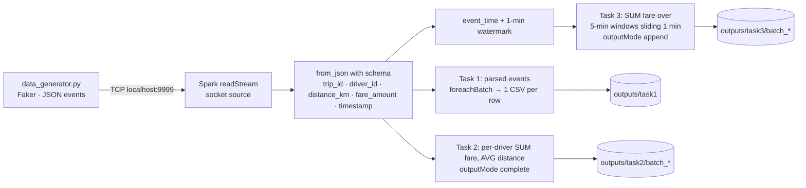

# Spark Streaming Ride-Sharing Analytics

A real-time analytics pipeline for a ride-sharing platform built with **Spark Structured Streaming**. It ingests a live JSON event feed from a socket, computes driver-level aggregations per micro-batch, and runs **event-time windowed** fare analytics with watermarks.


## Problem

Ride-sharing operations teams need live numbers, such as how much each driver has earned and how revenue is trending in the last few minutes, not yesterday's batch report. That calls for streaming ingestion, stateful aggregation, and correct handling of late, out-of-order events.

## Architecture



## Tech stack

| Area | Tools |
|---|---|
| Streaming | Spark Structured Streaming: socket source, `from_json`, `foreachBatch`, complete and append output modes |
| Event time | `withWatermark` (1 min), sliding `window` (5 min / 1 min) |
| Data generator | Python sockets + Faker |

## How to run

**Prerequisites:** Python 3, Java 17, `pip install -r requirements.txt` (pyspark 3.5.1, faker).

```bash
# Terminal 1: start the live feed
python data_generator.py            # streams one JSON event per line to localhost:9999

# Terminal 2: run one task at a time
python task1.py                     # ingestion & parsing
python task2.py                     # driver aggregations
python task3.py                     # windowed fare trends (needs a few minutes for windows to close)
```

If you change a schema or output mode and hit a checkpoint error, clear the state with `rm -rf checkpoints/task*`.

## Results

From the committed outputs ([`outputs/`](outputs/)):

- **Task 1:** each parsed event lands as its own CSV, for example `47.74 km · driver 55 · $13.27 · 2025-10-14 17:19:44`.
- **Task 2:** 5 micro-batches of running driver totals. By batch 4 the job tracks **34 drivers**; for example, driver 65 has $139.84 total fare and a 28.42 km average distance.
- **Task 3:** the 5-minute window **17:37–17:42** closed with **$23,685.09** in total fares, emitted once, after the watermark passed.

## Screenshots

Not applicable: the outputs are the CSV micro-batches above.

## Repo structure

```
.
├── data_generator.py     # socket server streaming synthetic ride events
├── task1.py              # ingest + parse → CSV per row
├── task2.py              # driver-level aggregations per micro-batch
├── task3.py              # watermarked sliding-window fare sums
├── outputs/              # task1 / task2 / task3 results
└── requirements.txt
```
